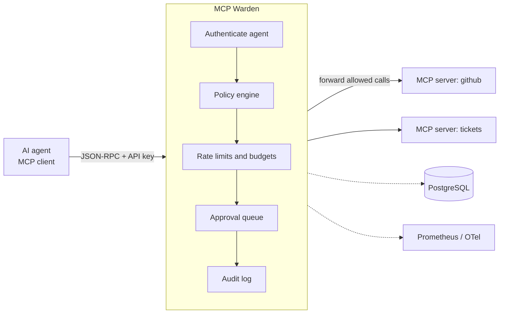

# MCP Warden

[](https://github.com/xeeshan16/mcp-warden/actions/workflows/ci.yml)
[](LICENSE)

**A self-hosted policy, budget and audit gateway for AI agent tool calls over the
[Model Context Protocol](https://modelcontextprotocol.io) (MCP).**

> Status: under active development (day 4 of a 14-day build). See
> [docs/PLAN.md](docs/PLAN.md) for the roadmap and [docs/PROGRESS.md](docs/PROGRESS.md)
> for the daily log. Features marked _planned_ are not implemented yet.

## The problem

Teams are wiring AI agents to MCP servers that can read tickets, open pull requests,
query databases and send messages. Each MCP server exposes every tool it has to every
client that connects, and most agent frameworks offer little control beyond "connect"
or "don't". That leaves platform teams without answers to basic questions:

- Which agent is allowed to call which tool on which server?
- How do we stop a looping agent from making 10,000 calls overnight?
- Which actions need a human to sign off first?
- What did each agent actually do, and when, without logging sensitive payloads?

MCP Warden sits between agents and MCP servers and answers those questions centrally,
with a policy file you can review in a pull request.

## Features

| Feature | Status |
| --- | --- |
| Policy-as-code (YAML): allow / deny / require_approval by agent, server and tool glob | ✅ day 1 |
| Deny-overrides resolution that rule order can never weaken | ✅ day 1 |
| Policy validation CLI with dry-run decisions (`mcp-warden check`) | ✅ day 1 |
| Policy dry-run HTTP API (`POST /v1/policy/evaluate`) | ✅ day 1 |
| Hardened JSON-RPC 2.0 parser (size, depth and batch limits; duplicate keys rejected) | ✅ day 2 |
| Typed MCP messages (`initialize`, `tools/list`, `tools/call`) and protocol negotiation | ✅ day 2 |
| MCP proxy over Streamable HTTP (`POST /mcp/{server}`), JSON and SSE upstream replies | ✅ day 3 |
| Upstream registry; upstream credentials resolved from env vars, never sent by agents | ✅ day 3 |
| Upstream timeouts, size caps and error mapping to JSON-RPC errors | ✅ day 3 |
| Deterministic fake MCP server for tests and demos (`mcp-warden fake-upstream`) | ✅ day 3 |
| Policy enforcement on `tools/call` and `tools/list` filtering in the proxy | ✅ day 4 |
| Argument matchers on tool calls (equals, one_of, glob, regex, present, max_length, min/max) | ✅ day 4 |
| Per-agent API keys (hashed at rest) | _planned_ |
| Rate limits (token bucket per agent and tool) | _planned_ |
| Call and token budgets per time window | _planned_ |
| Human approval queue for risky tools | _planned_ |
| Metadata-only audit log (no payloads stored) | _planned_ |
| Prometheus metrics and OpenTelemetry tracing | _planned_ |
| PostgreSQL persistence, Docker Compose demo | _planned_ |

## Architecture



So far the policy engine (day 1), the JSON-RPC / MCP message layer (day 2), the proxy
path to upstream servers (day 3) and policy enforcement inside the proxy (day 4) are in
place. Agent authentication, rate limits, budgets, approvals and the audit log land over
the following days (see the plan).

### Policy resolution

Every rule whose `agents`, `servers` and `tools` patterns all match the request is
collected. The most restrictive effect wins: `deny` > `require_approval` > `allow`.
If no rule matches, the policy `default` applies (and it defaults to `deny`).
Because the result does not depend on rule order, appending an `allow` rule can never
override an existing `deny`.

```yaml
version: 1
default: deny
rules:
  - id: read-only-everywhere
    effect: allow
    tools: ["get_*", "list_*", "search_*", "read_*"]
  - id: writes-need-a-human
    effect: require_approval
    servers: ["github"]
    tools: ["create_*", "update_*", "merge_*", "push_*"]
  - id: never-destructive
    effect: deny
    tools: ["delete_*", "drop_*", "*_delete", "purge_*"]
```

Unknown keys, duplicate rule ids, empty pattern lists and unsupported versions are
rejected at load time, so a typo fails loudly instead of silently widening access.

#### Argument matchers

A rule can also look at the `tools/call` arguments. It then applies only when every
matcher holds:

```yaml
  - id: no-pushes-to-default-branch
    effect: deny
    servers: ["github"]
    tools: ["push_*", "create_or_update_file"]
    arguments:
      - {path: branch, one_of: ["main", "master"]}

  - id: short-sleeps-only
    effect: deny
    servers: ["demo"]
    tools: ["sleep"]
    arguments:
      - {path: seconds, min: 0, max: 2, not: true}   # also denies a missing value
```

| Operator | Holds when the value at `path` … |
| --- | --- |
| `equals` / `one_of` | equals the given JSON value(s); typed, so `1` never equals `true` |
| `glob` / `regex` | is a string matching the glob, or fully matching the regex |
| `present` | resolves (`true`) or does not resolve (`false`) |
| `max_length` | is a string, list or object of at most that length |
| `min` / `max` | is a number within the inclusive bounds (may be combined) |

`path` uses dot notation (`options.mode`, `files.0`). A missing value never satisfies an
operator other than `present: false`, and `not: true` negates the result, so a negated
deny fails closed. Each matcher takes exactly one operator; invalid regexes and inverted
ranges are rejected at load time. Globs are plain string matching, not path
normalisation: to fence a file path, prefer a `regex` and a deny rule for `..`.
Regexes come from the policy author, who is trusted; keep them simple.

### Parsing untrusted JSON-RPC

Everything an agent sends passes through `mcp_warden.jsonrpc.parse_payload` before any
decision is made. It enforces a byte cap before decoding, strict UTF-8, a nesting-depth
cap and a batch-size cap, and it rejects `NaN`/`Infinity` literals and **duplicate object
keys**: if `{"name": "get_issue", "name": "delete_repo"}` were accepted, the gateway and
the upstream server could disagree about which tool is being called. Invalid entries in a
batch get their own JSON-RPC error instead of failing the whole batch.

Gateway refusals use codes from the JSON-RPC server-error range so clients can tell them
apart from upstream failures:

| Code | Meaning |
| --- | --- |
| -32001 | denied by policy |
| -32002 | human approval required |
| -32003 | rate limited |
| -32004 | budget exhausted |
| -32005 / -32006 | upstream error / upstream timeout |
| -32007 | payload too large |
| -32008 | unauthenticated |

MCP revisions from 2025-06-18 onward removed JSON-RPC batching, so batches are only
accepted when the client declares an older revision in `MCP-Protocol-Version`.

### Proxying to upstream servers

Agents talk to `POST /mcp/{server}`, where `server` is a name from the upstream registry
(`examples/upstreams.yaml`). For each message the gateway:

1. refuses unknown server names with a 404 before any network call;
2. parses the payload with the hardened parser above;
3. forwards requests and returns the upstream's response, whether the upstream answered
   with `application/json` or a `text/event-stream`; notifications are acknowledged
   with `202`;
4. maps failures to JSON-RPC errors that keep the request id: connection failures and
   HTTP errors become `-32005`, exceeding the upstream's deadline becomes `-32006`
   (the deadline covers the whole reply, so an SSE stream that only sends keep-alives
   still times out), and oversized, malformed or mismatched replies become `-32005`.

Only `Mcp-Session-Id` and `MCP-Protocol-Version` are passed from the agent to the
upstream. The agent's own `Authorization` header and cookies are for the gateway and are
never forwarded; upstream credentials are configured per server with `headers_from_env`,
which names an environment variable read at startup. A missing variable stops startup.
When an upstream answers `404` for a session id, the 404 is passed through so the client
starts a new session, as MCP specifies. Batch entries are forwarded one by one, so later
per-call checks apply the same way whether or not calls were batched.

### Enforcing the policy

Inside the proxy, each `tools/call` is validated and then evaluated with the agent, the
upstream name, the tool name and its arguments **before** anything is forwarded:

- `deny` → error `-32001` with the deciding rule; the upstream never sees the call;
- `require_approval` → error `-32002` (parking the call for a human arrives on day 8);
- `allow` → forwarded.

`tools/list` replies are filtered so an agent is only shown tools it could ever call.
A tool is hidden when an unconditional `deny` applies, or when no rule could permit it
and the default is `deny`. Rules with argument matchers keep a tool visible, since the
arguments are only known at call time (the call itself is still checked). Everything
else in the result (the pagination cursor, `_meta`, each tool's schema and annotations)
is forwarded untouched, and a `tools/list` result the gateway cannot read is refused
with `-32005` instead of being passed through unfiltered. Batch entries are checked one
by one.

Until per-agent API keys land on day 5, the agent id is taken from the `X-Warden-Agent`
header (missing means `anonymous`). That header is only as trustworthy as the network in
front of the gateway, so do not expose this build beyond a trusted network.

Not yet proxied: the optional `GET` stream for server-initiated messages and `DELETE`
session teardown (both answered with `405`, which MCP allows), and server-to-client
messages interleaved on a POST's SSE stream, which are currently dropped.

## Quick start

Requires Python 3.12+ and [uv](https://docs.astral.sh/uv/).

```bash
git clone https://github.com/xeeshan16/mcp-warden.git
cd mcp-warden
uv sync

# Validate a policy and dry-run a decision
uv run mcp-warden check examples/policy.yaml \
  --agent ci-bot --server github --tool delete_repo

# Dry-run a decision over HTTP
uv run mcp-warden serve --policy examples/policy.yaml
curl -s localhost:8080/v1/policy/evaluate \
  -H 'content-type: application/json' \
  -d '{"agent":"ci-bot","server":"github","tool":"create_pull_request"}'
```

### Proxy a session to the fake MCP server

```bash
# Terminal 1: the deterministic fake upstream (add --sse to answer with event streams)
uv run mcp-warden fake-upstream --port 9001

# Terminal 2: the gateway, with examples/upstreams.yaml pointing "demo" at it
uv run mcp-warden serve

# Terminal 3: an MCP session through the gateway
curl -si localhost:8080/mcp/demo -H 'content-type: application/json' -d \
  '{"jsonrpc":"2.0","id":0,"method":"initialize","params":{"protocolVersion":"2025-11-25","capabilities":{},"clientInfo":{"name":"curl","version":"1"}}}'
# copy the mcp-session-id response header, then:
curl -s localhost:8080/mcp/demo -H 'content-type: application/json' \
  -H 'mcp-session-id: fake-session-1' -H 'mcp-protocol-version: 2025-11-25' -d \
  '{"jsonrpc":"2.0","id":1,"method":"tools/call","params":{"name":"get_forecast","arguments":{"city":"Lahore"}}}'
```

Output from a local run:

```text
HTTP/1.1 200 OK
mcp-session-id: fake-session-1
{"jsonrpc":"2.0","id":0,"result":{"protocolVersion":"2025-11-25","capabilities":{"tools":{"listChanged":false}},"serverInfo":{"name":"mcp-warden-fake-upstream","version":"1.0.0"}}}

{"jsonrpc":"2.0","id":1,"result":{"content":[{"type":"text","text":"{\"city\": \"Lahore\", \"condition\": \"fog\", \"high_c\": 14, \"synthetic\": true}"}],"isError":false,"structuredContent":{"city":"Lahore","condition":"fog","high_c":14,"synthetic":true}}}
```

With the fake upstream stopped, the same call returns
`{"jsonrpc":"2.0","id":3,"error":{"code":-32005,"message":"upstream unreachable","data":{"server":"demo"}}}`.

The example policy applies to that session too. Output from a local run with the same
two servers (the session id from `initialize` in `mcp-session-id`; error bodies were
pretty-printed and are wrapped here for width):

```text
$ tools/list (no X-Warden-Agent header, so agent "anonymous")
['echo', 'add', 'get_forecast', 'sleep']
$ tools/list with X-Warden-Agent: support-bot
['echo', 'add', 'get_forecast', 'create_ticket', 'sleep']

$ tools/call delete_records {"table": "users"} as support-bot
{"jsonrpc": "2.0", "id": 2, "error": {"code": -32001,
  "message": "tool call denied by policy: delete_records",
  "data": {"server": "demo", "tool": "delete_records", "effect": "deny",
           "rule_id": "never-destructive",
           "reason": "Destructive tools are never allowed through the gateway."}}}

$ tools/call sleep {"seconds": 30}
{"jsonrpc": "2.0", "id": 3, "error": {"code": -32001,
  "message": "tool call denied by policy: sleep",
  "data": {"server": "demo", "tool": "sleep", "effect": "deny",
           "rule_id": "short-sleeps-only",
           "reason": "Calls that would hold an upstream worker for more than two seconds."}}}

$ tools/call sleep {"seconds": 1}
{"jsonrpc":"2.0","id":4,"result":{"content":[{"type":"text","text":"slept 1s"}],"isError":false}}
```

The fake upstream's log showed four requests (`initialize`, two `tools/list`, one
`sleep`): the two denied calls never left the gateway.

Dry-run a call with arguments without any upstream:

```bash
uv run mcp-warden check examples/policy.yaml \
  --agent bot --server demo --tool sleep --arguments '{"seconds": 30}'
```

Configuration is read from `WARDEN_*` environment variables (`WARDEN_POLICY_PATH`,
`WARDEN_UPSTREAMS_PATH`, `WARDEN_HOST`, `WARDEN_PORT`, `WARDEN_LOG_LEVEL`, the parser
limits `WARDEN_MAX_MESSAGE_BYTES`, `WARDEN_MAX_JSON_DEPTH`, `WARDEN_MAX_BATCH_SIZE`, and
`WARDEN_MAX_UPSTREAM_RESPONSE_BYTES`).

## Development

```bash
uv run ruff check . && uv run ruff format --check .
uv run mypy
uv run pytest --cov=mcp_warden
```

CI runs the same lint, type-check, test and build steps on every push.

## License

[MIT](LICENSE)
