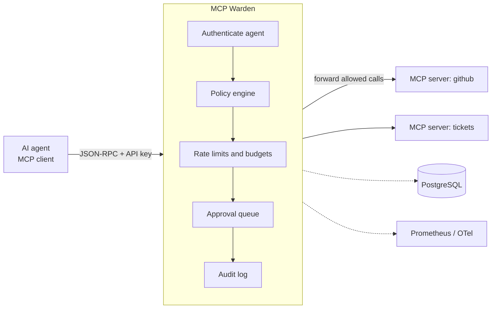

# MCP Warden

[](https://github.com/xeeshan16/mcp-warden/actions/workflows/ci.yml)
[](LICENSE)

**A self-hosted policy, budget and audit gateway for AI agent tool calls over the
[Model Context Protocol](https://modelcontextprotocol.io) (MCP).**

> Status: under active development (day 2 of a 14-day build). See
> [docs/PLAN.md](docs/PLAN.md) for the roadmap and [docs/PROGRESS.md](docs/PROGRESS.md)
> for the daily log. Features marked _planned_ are not implemented yet.

## The problem

Teams are wiring AI agents to MCP servers that can read tickets, open pull requests,
query databases and send messages. Each MCP server exposes every tool it has to every
client that connects, and most agent frameworks offer little control beyond "connect"
or "don't". That leaves platform teams without answers to basic questions:

- Which agent is allowed to call which tool on which server?
- How do we stop a looping agent from making 10,000 calls overnight?
- Which actions need a human to sign off first?
- What did each agent actually do, and when, without logging sensitive payloads?

MCP Warden sits between agents and MCP servers and answers those questions centrally,
with a policy file you can review in a pull request.

## Features

| Feature | Status |
| --- | --- |
| Policy-as-code (YAML): allow / deny / require_approval by agent, server and tool glob | ✅ day 1 |
| Deny-overrides resolution that rule order can never weaken | ✅ day 1 |
| Policy validation CLI with dry-run decisions (`mcp-warden check`) | ✅ day 1 |
| Policy dry-run HTTP API (`POST /v1/policy/evaluate`) | ✅ day 1 |
| Hardened JSON-RPC 2.0 parser (size, depth and batch limits; duplicate keys rejected) | ✅ day 2 |
| Typed MCP messages (`initialize`, `tools/list`, `tools/call`) and protocol negotiation | ✅ day 2 |
| MCP JSON-RPC proxy (Streamable HTTP) with `tools/list` filtering | _planned_ |
| Per-agent API keys (hashed at rest) | _planned_ |
| Argument constraints on tool calls | _planned_ |
| Rate limits (token bucket per agent and tool) | _planned_ |
| Call and token budgets per time window | _planned_ |
| Human approval queue for risky tools | _planned_ |
| Metadata-only audit log (no payloads stored) | _planned_ |
| Prometheus metrics and OpenTelemetry tracing | _planned_ |
| PostgreSQL persistence, Docker Compose demo | _planned_ |

## Architecture



So far the policy engine (day 1) and the JSON-RPC / MCP message layer (day 2) are in
place. The proxy path and the stages after the policy engine land over the following
days (see the plan).

### Policy resolution

Every rule whose `agents`, `servers` and `tools` patterns all match the request is
collected. The most restrictive effect wins: `deny` > `require_approval` > `allow`.
If no rule matches, the policy `default` applies (and it defaults to `deny`).
Because the result does not depend on rule order, appending an `allow` rule can never
override an existing `deny`.

```yaml
version: 1
default: deny
rules:
  - id: read-only-everywhere
    effect: allow
    tools: ["get_*", "list_*", "search_*", "read_*"]
  - id: writes-need-a-human
    effect: require_approval
    servers: ["github"]
    tools: ["create_*", "update_*", "merge_*", "push_*"]
  - id: never-destructive
    effect: deny
    tools: ["delete_*", "drop_*", "*_delete", "purge_*"]
```

Unknown keys, duplicate rule ids, empty pattern lists and unsupported versions are
rejected at load time, so a typo fails loudly instead of silently widening access.

### Parsing untrusted JSON-RPC

Everything an agent sends passes through `mcp_warden.jsonrpc.parse_payload` before any
decision is made. It enforces a byte cap before decoding, strict UTF-8, a nesting-depth
cap and a batch-size cap, and it rejects `NaN`/`Infinity` literals and **duplicate object
keys**: if `{"name": "get_issue", "name": "delete_repo"}` were accepted, the gateway and
the upstream server could disagree about which tool is being called. Invalid entries in a
batch get their own JSON-RPC error instead of failing the whole batch.

Gateway refusals use codes from the JSON-RPC server-error range so clients can tell them
apart from upstream failures:

| Code | Meaning |
| --- | --- |
| -32001 | denied by policy |
| -32002 | human approval required |
| -32003 | rate limited |
| -32004 | budget exhausted |
| -32005 / -32006 | upstream error / upstream timeout |
| -32007 | payload too large |
| -32008 | unauthenticated |

MCP revisions from 2025-06-18 onward removed JSON-RPC batching, so batches are only
accepted for sessions that negotiated an older revision.

## Quick start

Requires Python 3.12+ and [uv](https://docs.astral.sh/uv/).

```bash
git clone https://github.com/xeeshan16/mcp-warden.git
cd mcp-warden
uv sync

# Validate a policy and dry-run a decision
uv run mcp-warden check examples/policy.yaml \
  --agent ci-bot --server github --tool delete_repo

# Run the gateway (policy dry-run API for now)
uv run mcp-warden serve --policy examples/policy.yaml
curl -s localhost:8080/v1/policy/evaluate \
  -H 'content-type: application/json' \
  -d '{"agent":"ci-bot","server":"github","tool":"create_pull_request"}'
```

Configuration is read from `WARDEN_*` environment variables (`WARDEN_POLICY_PATH`,
`WARDEN_HOST`, `WARDEN_PORT`, `WARDEN_LOG_LEVEL`, and the parser limits
`WARDEN_MAX_MESSAGE_BYTES`, `WARDEN_MAX_JSON_DEPTH`, `WARDEN_MAX_BATCH_SIZE`).

## Development

```bash
uv run ruff check . && uv run ruff format --check .
uv run mypy
uv run pytest --cov=mcp_warden
```

CI runs the same lint, type-check, test and build steps on every push.

## License

[MIT](LICENSE)
