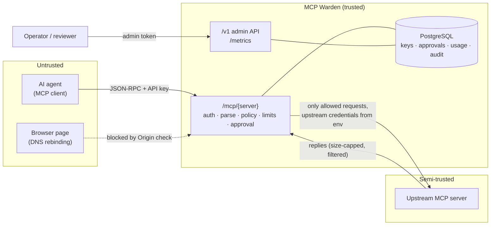

# MCP Warden threat model

This document describes what MCP Warden protects, who it protects it from, how each
threat is handled in the code, and what it deliberately does **not** cover. It is
written against the code on `main`; every mitigation names the module that implements
it and the tests that check it, so a claim here can be verified rather than trusted.

## What the gateway is for

MCP Warden sits between AI agents (MCP clients) and MCP servers. It decides, per
request, whether an agent may use a tool, a prompt or a resource on an upstream server,
enforces rate limits and budgets, parks risky tool calls for a human, and records a
metadata-only audit trail.

## Assets

| Asset | Why it matters |
| --- | --- |
| Upstream capabilities (tools, prompts, resources) | The actions and data the policy exists to control |
| Upstream credentials | Configured per server from environment variables; agents must never see or replace them |
| Agent API keys | Whoever holds one acts as that agent |
| Admin tokens | Approve parked calls, issue keys, reload the policy |
| The policy in force | Weakening it silently widens every agent's access |
| Audit log | Evidence of what each agent did; must not become a store of sensitive payloads |
| Gateway availability | Agents and the work they do stop when the gateway does |

## Actors and trust

- **Agents** are untrusted. An agent may be buggy, looping, or steered by prompt
  injection in content it read, so everything it sends is treated as hostile input.
- **Upstream MCP servers** are semi-trusted: the operator chose them, but their
  replies are still parsed with limits and their listings are filtered, never passed
  through blindly.
- **Operators and reviewers** hold admin tokens and are trusted, including the policy
  author: regexes in the policy are not sandboxed.
- **Browsers** on the operator's machine are untrusted: a malicious page can try to
  reach a gateway on `localhost` through DNS rebinding.

## Threats and mitigations

### Spoofing

| Threat | Mitigation | Where | Tests |
| --- | --- | --- | --- |
| An agent claims another agent's identity | Per-agent API keys (`mcpw_` prefix + secret); only a SHA-256 hash is stored, compared in constant time; expiry and revocation | `identity/` | `test_keys.py`, `test_auth.py`, `test_proxy_auth.py` |
| The `X-Warden-Agent` header is trusted in production | `trusted-header` mode is opt-in for development behind an authenticating proxy, and logs a warning at startup; API keys are the default | `config.py`, `identity/auth.py` | `test_auth.py` |
| An admin token is guessed | Tokens must be at least 16 characters, are compared in constant time, and are named so actions are attributable | `admin/auth.py`, `config.py` | `test_admin_auth.py` |
| A browser page drives a local gateway (DNS rebinding) | Requests to `/mcp/*` that carry an `Origin` header must name an allowed origin (`WARDEN_ALLOWED_ORIGINS`, empty by default), as the MCP transport spec requires | `proxy/headers.py`, `app.py` | `test_headers.py` |

### Tampering

| Threat | Mitigation | Where | Tests |
| --- | --- | --- | --- |
| The gateway and the upstream read a message differently (parser differential) | Duplicate JSON keys, `NaN`/`Infinity`, invalid UTF-8 and unknown envelope members are rejected; every forwarded message is re-serialised from the validated model | `jsonrpc/parser.py`, `jsonrpc/messages.py` | `test_jsonrpc_parser.py`, `test_properties.py` |
| A repeated `Mcp-Session-Id` or `MCP-Protocol-Version` header is read differently by the two sides | Each may appear once; values are validated (visible ASCII session ids, `YYYY-MM-DD` versions) | `proxy/headers.py` | `test_headers.py` |
| A made-up protocol version unlocks JSON-RPC batches | Batches are only allowed for well-formed revisions older than 2025-06-18; `0` used to compare as older and is now a 400 | `proxy/headers.py`, `jsonrpc/mcp.py` | `test_headers.py` |
| A resource URI is spelled to slip past a glob (`docs/../internal`, `%2e%2e`, `\`, `DEMO://`) | URIs with dot segments, backslashes, encoded `.`/`/`/`\` or a non-lowercase scheme are refused with `-32602` before the policy is consulted; listings hide such URIs | `jsonrpc/mcp.py` | `test_prompts_resources.py` |
| An edit to the policy silently weakens a deny | Resolution is deny-overrides and order-independent: adding a rule can never turn an existing rule's decision into a weaker one | `policy/engine.py` | `test_policy_engine.py`, `test_properties.py` (rule order and monotonicity properties) |
| A broken policy file takes effect on reload | Reloads validate first and keep the last good policy on error; the failure is reported and counted | `policy/reload.py` | `test_policy_reload.py` |
| An approval is replayed for a different call | Approvals are bound to a fingerprint of agent, server, tool and arguments, single-use, and expire | `approval/` | `test_approval_gate.py`, `test_proxy_approval.py` |

### Repudiation

| Threat | Mitigation | Where | Tests |
| --- | --- | --- | --- |
| An agent's actions cannot be reconstructed | One audit event per request: agent, server, method, tool, decision, rule, approval id, outcome, latency, argument digest and size | `audit/` | `test_proxy_audit.py` |
| An approval cannot be attributed | Decisions are recorded under the authenticated admin's name; one admin cannot decide as another | `app.py`, `admin/auth.py` | `test_admin_auth.py` |

### Information disclosure

| Threat | Mitigation | Where | Tests |
| --- | --- | --- | --- |
| An agent sees tools, prompts or resources it may never use | `tools/list`, `prompts/list` and `resources/list` are filtered per agent; an unreadable listing is refused, never passed through unfiltered | `proxy/enforcement.py` | `test_proxy_policy.py`, `test_prompts_resources.py` |
| Completions reveal what a hidden prompt takes | `completion/complete` for a prompt the agent could never fetch is refused | `proxy/enforcement.py` | `test_prompts_resources.py` |
| Agent credentials reach the upstream | Only `Mcp-Session-Id` and `MCP-Protocol-Version` cross; `Authorization`, cookies and everything else stay at the gateway | `proxy/headers.py`, `proxy/client.py` | `test_headers.py`, `test_proxy_auth.py` |
| Upstream credentials leak to agents | They are read from environment variables named in the registry and only ever sent upstream | `upstreams.py` | `test_upstreams.py` |
| The audit log becomes a copy of sensitive payloads | Arguments are stored as a digest and a size only (HMAC-SHA-256 with `WARDEN_AUDIT_HASH_KEY`, so small values cannot be recovered by guessing); results are never stored | `audit/model.py` | `test_audit_model.py`, `test_proxy_audit.py` |
| Traces carry session ids or arguments | Spans carry metadata only; MCP session ids, arguments and upstream credentials are kept out | `observability/tracing.py` | `test_tracing.py` |
| A new API key is cached or sniffed by an intermediary | Every response is `Cache-Control: no-store` and `X-Content-Type-Options: nosniff`; keys are shown once | `app.py` | `test_headers.py`, `test_admin_api.py` |
| The stack is fingerprinted | `mcp-warden serve` sends no `Server` header | `__main__.py` | — |

### Denial of service

| Threat | Mitigation | Where | Tests |
| --- | --- | --- | --- |
| Huge or deeply nested payloads | Byte cap before decoding (also enforced while streaming the body), depth cap, batch-size cap | `jsonrpc/parser.py`, `app.py` | `test_jsonrpc_parser.py`, `test_properties.py` |
| Large bodies on the admin API | Bodies outside `/mcp/*` are capped at `WARDEN_MAX_REQUEST_BYTES` (64 KiB), including chunked bodies without a length | `app.py` | `test_headers.py` |
| A looping agent exhausts an upstream | Token-bucket rate limits per agent or per tool, and call and token budgets per window; shared through the database across instances | `ratelimit/`, `budget/` | `test_proxy_rate_limit.py`, `test_proxy_budget.py` |
| A slow or huge upstream reply ties up the gateway | Per-upstream deadline over the whole reply (including SSE keep-alives) and a response size cap | `proxy/client.py` | `test_upstream_client.py`, `test_sse.py` |
| Agents flood the approval queue | Pending requests per agent are capped | `approval/` | `test_approval_stores.py`, `test_proxy_approval.py` |
| Agent-chosen names blow up metric cardinality | Label values are bounded; overflow goes to `__other__` | `observability/metrics.py` | `test_metrics.py` |

### Elevation of privilege

| Threat | Mitigation | Where | Tests |
| --- | --- | --- | --- |
| A tool rule's `*` is read as permission for prompts or resources | Each rule applies to one kind (tools, prompts or resources); the default covers all three, so new kinds are refused under `default: deny` | `policy/model.py`, `policy/engine.py` | `test_prompts_resources.py`, `test_properties.py` |
| A denied call reaches the upstream anyway | Policy, approval, rate limit and budget run before forwarding; a fuzzed gateway is checked never to forward a denied call, whatever the body and headers | `proxy/service.py` | `test_proxy_policy.py`, `test_properties.py` |
| A hidden tool is callable | A tool is hidden only if every possible call is denied; checked as a property over generated policies and arguments | `policy/engine.py` | `test_properties.py` |
| The container is used to escalate on the host | Non-root user (uid 10001), read-only root filesystem, no capabilities, `no-new-privileges` in Compose | `Dockerfile`, `compose.yaml` | CI `compose` job |

## Out of scope and residual risks

These are known gaps, stated so nobody assumes otherwise:

- **Content is not inspected.** The gateway decides on who, what and with which
  arguments; it does not scan tool results, prompt messages or resource contents for
  prompt injection or secrets. A tool that is allowed can return anything its server
  returns, including the contents of a resource the policy denies.
- **Resource templates and resource completions are not filtered.** A template is not a
  URI; every URI built from one is still checked when it is read.
- **URI globs are string matches.** Ambiguous spellings are refused, but two different
  URIs that an upstream maps to the same object (for example through its own aliases)
  are distinct to the policy. Prefer deny rules on broad prefixes plus narrow allows.
- **Server-to-client traffic is not relayed.** The optional `GET` stream returns `405`,
  and server-initiated requests (sampling, elicitation) on a POST's SSE stream are
  dropped, so they cannot bypass the policy but are also not available to agents.
- **TLS is not terminated by the gateway.** Run it behind a TLS-terminating proxy or
  service mesh; Compose binds it to loopback only.
- **Admin access is all or nothing.** Named tokens identify reviewers, but there are no
  read-only roles yet.
- **Unauthenticated floods** are bounded only by the body cap and parse limits, since
  rate limits are per authenticated agent. Put a connection or request limit in front.
- **In-memory stores are per instance.** Run more than one gateway with the database
  stores, or rate limits, budgets and approvals are not shared.
- **Policy regexes are trusted.** A pathological regex from the policy author can be
  slow; keep them simple and review them like code.
